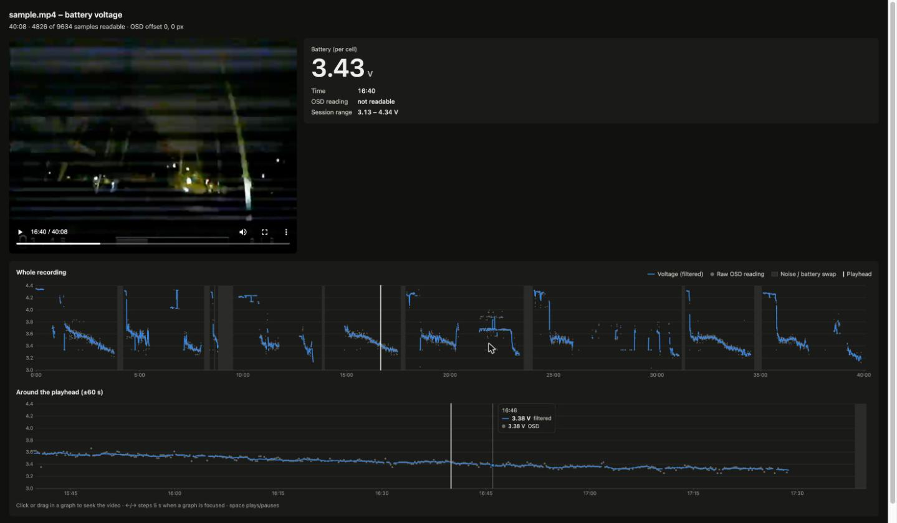
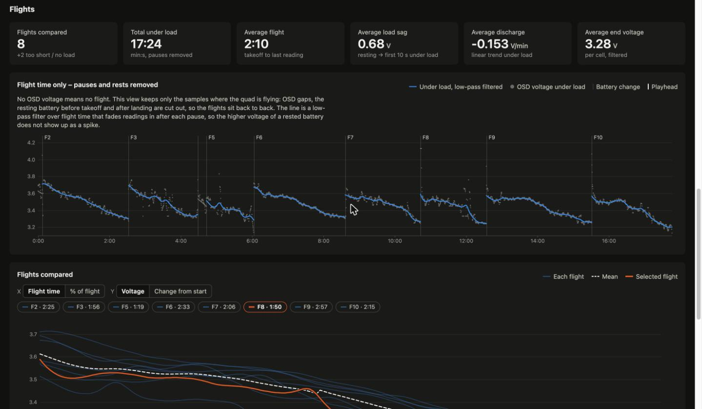

# white-noise-separator

Tools for analog FPV recordings (goggles / DVR captures):

- `noisesplit.py` splits a recording into chunks wherever the picture turns
  into white noise for more than a second — e.g. every battery swap.
- `osdvoltage.py` reads the battery voltage from the OSD and builds an HTML
  viewer that shows the voltage graph while you scrub through the video
  (see [Battery voltage from the OSD](#battery-voltage-from-the-osd)).

Detection uses **only the video stream** (the audio of such recordings is
noisy all the time anyway).

## Requirements

- `ffmpeg` / `ffprobe` on `PATH` (`brew install ffmpeg`)
- Python 3.9+ with `numpy` (`pip install numpy`)

## Usage

```sh
# just look at what would be cut
./noisesplit.py --dry-run recording.mp4

# split into recording_chunks/recording_001.mp4, _002.mp4, ...
./noisesplit.py recording.mp4

# fast lossless split (cuts snap to keyframes, so a bit of noise may remain)
./noisesplit.py --copy recording.mp4
```

Example run on a 40-minute FPV recording (`sample.mp4`, not in the repo):

```
$ python3 noisesplit.py sample.mp4
analyzing   2400.0s / 2408.4s ( 99.6%)

9 noise section(s):
  00:03:56.275 - 00:04:13.041  (  16.8s)
  00:08:07.775 - 00:08:11.953  (   4.2s)
  00:08:36.808 - 00:08:40.446  (   3.6s)
  00:08:48.317 - 00:09:31.973  (  43.7s)
  00:13:49.390 - 00:13:58.054  (   8.7s)
  00:17:38.342 - 00:17:51.884  (  13.5s)
  00:23:34.392 - 00:24:00.916  (  26.5s)
  00:31:13.300 - 00:31:22.387  (   9.1s)
  00:34:42.954 - 00:35:05.441  (  22.5s)

10 chunk(s):
    1  00:00:00.000 - 00:03:56.275  (  236.3s)
    2  00:04:13.041 - 00:08:07.775  (  234.7s)
    3  00:08:11.953 - 00:08:36.808  (   24.9s)
    4  00:08:40.446 - 00:08:48.317  (    7.9s)
    5  00:09:31.973 - 00:13:49.390  (  257.4s)
    6  00:13:58.054 - 00:17:38.342  (  220.3s)
    7  00:17:51.884 - 00:23:34.392  (  342.5s)
    8  00:24:00.916 - 00:31:13.300  (  432.4s)
    9  00:31:22.387 - 00:34:42.954  (  200.6s)
   10  00:35:05.441 - 00:40:08.448  (  303.0s)
[1/10] 00:00:00.000 - 00:03:56.275 -> sample_chunks/sample_001.mp4
[2/10] 00:04:13.041 - 00:08:07.775 -> sample_chunks/sample_002.mp4
[3/10] 00:08:11.953 - 00:08:36.808 -> sample_chunks/sample_003.mp4
[4/10] 00:08:40.446 - 00:08:48.317 -> sample_chunks/sample_004.mp4
[5/10] 00:09:31.973 - 00:13:49.390 -> sample_chunks/sample_005.mp4
[6/10] 00:13:58.054 - 00:17:38.342 -> sample_chunks/sample_006.mp4
[7/10] 00:17:51.884 - 00:23:34.392 -> sample_chunks/sample_007.mp4
[8/10] 00:24:00.916 - 00:31:13.300 -> sample_chunks/sample_008.mp4
[9/10] 00:31:22.387 - 00:34:42.954 -> sample_chunks/sample_009.mp4
[10/10] 00:35:05.441 - 00:40:08.448 -> sample_chunks/sample_010.mp4
```

Next to the chunks, a `segments.json` lists the detected noise sections and
chunk boundaries.

By default the chunks are re-encoded with x264 (`--crf 18`), so the cuts are
frame-accurate. Use `--preset veryfast` to speed that up.

### All options

```
usage: noisesplit.py [-h] [-o OUTDIR] [--min-noise MIN_NOISE]
                     [--min-chunk MIN_CHUNK] [--merge-gap MERGE_GAP]
                     [--min-density MIN_DENSITY] [--extend-gap EXTEND_GAP]
                     [--max-extend MAX_EXTEND] [--pad PAD] [--tc-max TC_MAX]
                     [--vc-max VC_MAX] [--band-min BAND_MIN]
                     [--weak-tc WEAK_TC] [--copy] [--crf CRF]
                     [--preset PRESET] [-n] [--features-csv FEATURES_CSV] [-q]
                     input

Split an analog video recording at white-noise sections.

positional arguments:
  input                 input video (e.g. .mp4)

options:
  -h, --help            show this help message and exit
  -o, --outdir OUTDIR   output directory (default: <input>_chunks)
  --min-noise MIN_NOISE
                        minimum noise duration in seconds to split at (default
                        1.0)
  --min-chunk MIN_CHUNK
                        drop chunks shorter than this many seconds (default
                        2.0)
  --merge-gap MERGE_GAP
                        merge noise sections separated by <= this many seconds
                        (default 1.0)
  --min-density MIN_DENSITY
                        fraction of a section that must be clear noise;
                        rejects interference during normal footage (default
                        0.5)
  --extend-gap EXTEND_GAP
                        when growing a noise section over its ragged edges,
                        stop after this many seconds of clean picture (default
                        0.3)
  --max-extend MAX_EXTEND
                        grow a noise section by at most this many seconds per
                        side (default 3)
  --pad PAD             extra seconds cut away on both sides of each noise
                        section (default 0.1)
  --tc-max TC_MAX       max frame-to-frame correlation for noise (default 0.2)
  --vc-max VC_MAX       max row-to-row correlation for noise (default 0.5)
  --band-min BAND_MIN   frames whose variance is at least this much explained
                        by row means count as sync-loss bands (default 0.8)
  --weak-tc WEAK_TC     frames below this frame-to-frame correlation count as
                        disturbed when growing noise sections (default 0.35)
  --copy                stream-copy instead of re-encoding (fast, but cuts
                        snap to keyframes)
  --crf CRF             x264 CRF when re-encoding (default 18)
  --preset PRESET       x264 preset (default medium)
  -n, --dry-run         only detect and report, do not write video chunks
  --features-csv FEATURES_CSV
                        write per-frame features to this CSV for tuning
  -q, --quiet
```

## How it works

Every frame is decoded (at its real timestamp — analog captures are often
variable frame rate), scaled down to 160×120 grayscale and measured:

| feature | snow | sync-loss bands | real picture |
|---|---|---|---|
| correlation with the previous frame | ~0 | medium | high |
| correlation between neighbouring rows | ~0 | high | high |
| share of variance explained by row means | low | ~1 | low |

A frame is *noise* if it is snow (both correlations low) or bands
(row share > `--band-min`). Noise frames are grouped into sections
(gaps up to `--merge-gap` are bridged); a section counts if it is at least
`--min-noise` seconds long **and** at least `--min-density` of it is noise —
that rejects interference/breakup during normal flight. Sections are then
grown over their ragged on/off transitions and padded by `--pad`.

## Tuning

Write the per-frame measurements to a CSV and look at them:

```sh
./noisesplit.py -n recording.mp4 --features-csv features.csv
```

All thresholds are options; see [All options](#all-options).

## Tests

```sh
python3 -m unittest -v
```

The test builds a synthetic clip with ffmpeg (test pattern, snow, bands) and
checks detection and splitting.

## Battery voltage from the OSD

`osdvoltage.py` reads the per-cell battery voltage that a Betaflight-style
analog OSD shows in the bottom-left corner (`🔋 3.52v`) and writes

- `<input>_voltage.json` — the time series, and
- `<input>_voltage.html` — a viewer: the video next to a voltage graph of the
  whole recording plus a ±60 s detail graph. Click or drag in a graph to seek;
  the playhead and the big readout follow the video. A table view lists
  10-second medians. Below that, a flight analysis compares all batteries
  (see [Flights: comparing batteries](#flights-comparing-batteries)).

```sh
./noisesplit.py -n sample.mp4 --report sample_segments.json   # optional: noise bands in the graph
./osdvoltage.py sample.mp4 --segments sample_segments.json
open sample_voltage.html
```



The HTML references the video by relative path, so keep the two together.
Open it straight from disk (`file://`). If you serve it over HTTP, the server
must support range requests, or the browser can't seek in the video
(Python's `http.server` doesn't).

### Flights: comparing batteries

Below the recording graphs the viewer has a **Flights** section:

- **Stat tiles:** number of flights, total time under load, average flight
  time, average load sag, discharge rate and end voltage.
- **Flight time only:** the voltage with all pauses removed. The x axis counts
  only time under load, so the flights sit back to back. Click to seek.
- **Flights compared:** all flights overlaid from takeoff, with their mean.
  Toggle the x axis between flight time and % of flight, and the y axis
  between voltage and change from the start-of-flight voltage. Hover or pick
  a chip to highlight one flight; click to jump the video there.
- **Per-flight table:** rest voltage, start/end/mean voltage under load, sag,
  V/min trend, time until 3.50 V, number of pauses.



How the flights are derived from the voltage series:

1. **No OSD voltage = no flight.** Readable stretches separated by more than
   `--gap` seconds (default 3) without OSD are pauses.
2. **Batteries.** A pause starts a new flight when the voltage afterwards is
   ≥ 0.3 V higher than before *and* looks like a full pack (≥ 4.1 V/cell) or
   a noise section (battery swap) lies in the pause.
3. **Under load vs. resting.** An unloaded battery reads several tenths of a
   volt higher. Resting stretches are cut out:
   - the plateau before takeoff and after landing (a level stretch followed
     or preceded by a fast sag of ≥ 0.15 V; also when the quad is held in
     the hand with the OSD on);
   - any stretch where the reading is perfectly flat, since it always
     jitters under load.
   Flights shorter than `--min-flight` seconds under load (default 30) are
   listed but not compared.
4. **Low-pass filter.** On the pauses-removed time axis, a weighted Gaussian
   low-pass (`--lowpass` sigma, default 4 s) smooths each flight. After every
   pause (and at takeoff) the readings are faded in linearly over `--settle`
   seconds (default 15). That way the higher voltage of a battery that
   recovered during the pause doesn't show up as a spike; the curve bridges
   it from the readings around it.

The flight analysis only needs the voltage series, so you can redo it (for
example with other parameters) without reading the video again:

```sh
./osdvoltage.py sample_voltage.json --settle 20 --min-flight 45
```

The JSON gains an `analysis` object: `flights` (per-flight stats, plus the
filtered curve `v` on a 1 s grid of flight time `ft` with matching video
times `t`), a `summary`, and per-sample `rest`, `ft` (cumulative flight time,
`null` when not flying) and `lowpass`.

### How it reads the digits

1. 4 frames/s are decoded and scaled to 640×480; only the bottom-left corner
   is kept.
2. The OSD position is auto-calibrated once per file (override with
   `--offset DX DY`).
3. Each of the three digit cells of `D.DDv` is compared, with a ±3 px shift
   search, to a bank of hand-labelled digit images from this OSD font
   (`osd_digits.npz`, 1-nearest-neighbour on normalised pixels). The bank
   also has a *junk* class for noise and frames without OSD.
4. Low-similarity or implausible readings (outside `--vmin`/`--vmax`) are
   dropped. The rest are median-filtered over `--window` seconds; raw
   readings further than `--max-dev` from the median are treated as misreads.

The JSON holds `t` (seconds), `raw` (the OSD reading or `null`),
`confidence` (worst digit similarity) and `voltage` (filtered, `null` where
unknown), plus `noise` sections and summary `stats`.

Accuracy on the sample: about half of all frames are readable. The rest are
noise, goggle menus or the post-flight stats screen. Spot checks of
readable frames are mostly exact. Digits on a very bright background
(snow, sky) are the weak spot, and the median filter absorbs most of those.
The digit bank was labelled from one DVR/goggle setup; a different OSD font
or resolution will need new labels.

### How the digit classifier was trained

There is no pre-trained OCR model involved. The classifier is a labelled
image bank plus nearest-neighbour matching, built from `sample.mp4` in this
session. Plain OCR (tesseract) was never actually tried, because the digits
are only about 10×17 px, blurry, and often on busy backgrounds. The steps:

1. **Find the digit cells.** Magnified crops of a few clean frames showed
   the `D.DDv` digits at x = 46 / 91 / 113 px, y = 443 px (at 640×480), each
   about 14×22 px, with a jitter of 1–2 px between frames. The bottom-left
   region was decoded at 4 fps, giving 9,634 frames.
2. **Seed templates (discarded).** First, one hand-picked clean example of
   each digit was used as a template, then refined by averaging confident
   matches ("self-training"). This drifted: 3, 5, 6, 8 and 9 are so similar
   at this size that the 5 and 9 templates turned into 3-like blobs. Also,
   in this font the 6 renders like an "E".
3. **Round 1 labels (cluster medoids).** Digit cells on a dark background
   were centred on their bright pixels and k-means clustered into 120
   groups. The most typical cell of each group was shown in a magnified,
   numbered montage and labelled by eye: 90 digits, 15 *junk* (noise or
   no OSD), and 14 skipped as ambiguous.
4. **Rounds 2 and 3 (targeted labels).** The classifier was run on all
   frames. Random cells it had predicted as the confusable digits (3/8/9,
   then 0/3/5/6/8/9) were shown in new montages and labelled: 29 + 43
   more. Again, anything not clearly readable was skipped.
5. **Bank.** That makes 177 labelled cells:

   | class | junk | 0 | 1 | 2 | 3 | 4 | 5 | 6 | 7 | 8 | 9 |
   |---|---|---|---|---|---|---|---|---|---|---|---|
   | cells | 15 | 8 | 3 | 6 | 53 | 17 | 22 | 22 | 3 | 19 | 9 |

   Each cell is stored with its ±1 px shifted copies (up to 9 per cell),
   giving 1,575 raw 8-bit images in `osd_digits.npz`.
6. **Choosing the matcher.** The candidates were compared with 5-fold
   cross-validation, keeping all shifted copies of a cell in the same fold:

   | method | per-cell accuracy |
   |---|---|
   | 1-nearest-neighbour, normalised correlation | **91.9 %** |
   | logistic regression on pixels | 79 % |
   | PCA + LDA | 88 % (on its own training data) |
   | per-class mean templates | visibly worse 8/9/3 separation |

   1-NN was kept. At runtime each cell is normalised (zero mean, unit
   variance), compared against all 1,575 bank images at every ±3 px shift,
   and takes the label of the best match. The best similarity is the
   confidence.
7. **Check.** The filtered series shows the expected discharge curves:
   about 4.2–4.35 V at rest, sag on take-off, then a slow drop to about
   3.25 V per flight. Voltage jumps coincide with the battery swaps found
   by `noisesplit.py`. On exactly the sampled frames, 6 of 7 random
   readings matched the picture. The miss was a digit on a bright
   background.

Note: all labels were assigned by Claude from magnified montages; nobody
reviewed them by hand. The scripts used for clustering and labelling were
throwaway and are not in this repository, only their result
(`osd_digits.npz`). To extend the bank for another OSD font or more
accuracy, add labelled 22×14 cells (and their shifted copies) to that file.

## How this was built

This tool was written by Claude Code (model `claude-opus-5-5`) in a single
session on 2026-11-05, tuned against a 40-minute FPV recording.

### Original prompt

> build a tool that reads an mp4 file and identifies white noise areas (more
> than one second) and splits the file into individual chunks. use case: a
> recording of an analog video, every time I change the battery on the
> device, i have white noise. use the video stream, the audio is always quite
> noisy

(Mid-session follow-up: "I added a sample file (sample.mp4)".)

Follow-up prompt that added `osdvoltage.py`:

> can you look into the bottom left of the files, there is the battery
> voltage. can you read it and export it into a json and also write a html
> file with graphs and so I can see the voltage while scrubbing through the
> video.

### Usage / cost

From Claude Code `/usage` at the end of the session. This covers
everything: `noisesplit.py`, `osdvoltage.py` with the HTML viewer, tests
and README.

| | |
|---|---:|
| **Total cost** | **$9.45** |
| API time | 20 min 34 s |
| Wall-clock time | 1 h 21 min |
| Code changes | 871 lines added, 0 removed |

| model | input | output | cache read | cache write | cost |
|---|---:|---:|---:|---:|---:|
| `claude-opus-5-5` | 3.1k | 122.0k | 18.2M | 420.5k | $9.45 |
| `claude-haiku-5-5` | 1.2k | 19 | 0 | 0 | $0.0001 |

98% of input tokens were served from the prompt cache (123 requests).
By usage share, the biggest add-ons were browser automation
(`/claude-in-chrome`, 16%), used to test the HTML viewer and take the
screenshot, and the `/dataviz` charting guidelines (6%).
